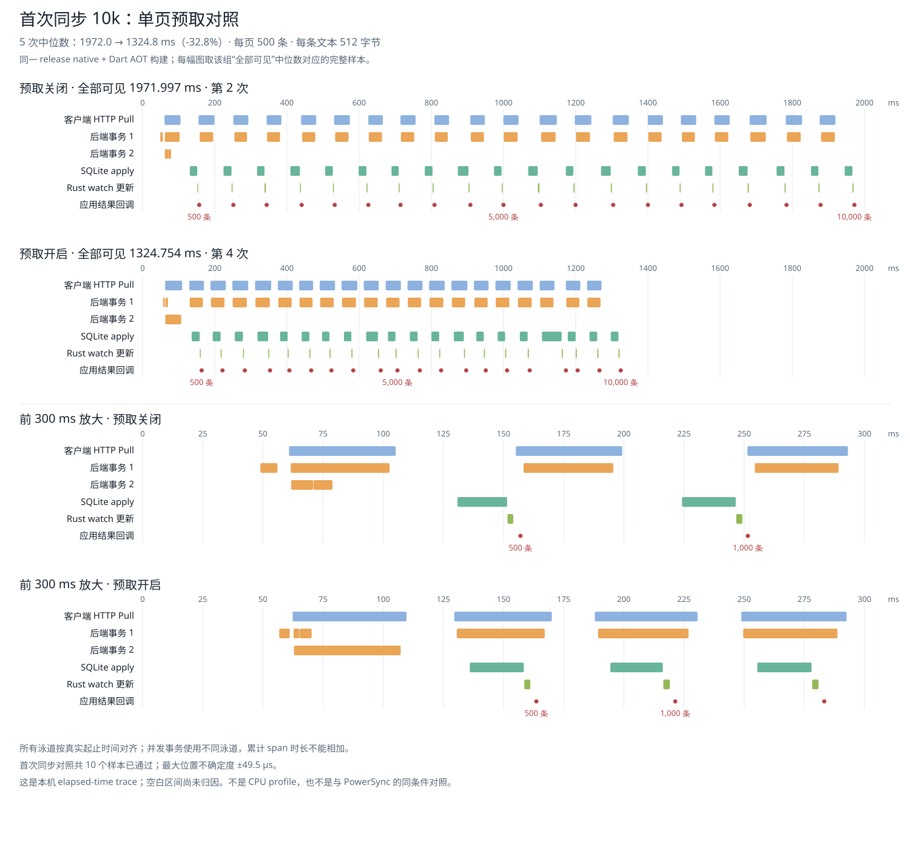

# Bounded Bootstrap prefetch experiment

Both conditions use the same clean commit `ab1c3bfb` and identical release
native/Dart AOT artifacts. The only selected difference is
`AXTON_EXPERIMENTAL_BOOTSTRAP_PREFETCH=0` versus `1`. This is an opt-in experiment;
it remains disabled by default and has not been merged or released.

The controller requests one successor of a complete admitted Bootstrap page
while the current page is waiting for or performing Store apply. Received-through
is an HTTP request position only. Store commits remain the authority for B/C,
and future pages cannot apply across an uncommitted predecessor. The page size
remains 500 rows. Ordinary live Sync and owned materialization keep their
existing scheduling policies.

## Results

All 30 samples passed final state, backend, settlement/report and clock checks:
five repetitions of each of three N = 10,000 scenarios per condition. The
instrumentation-3 timing contract, source and artifact fingerprints, machine,
toolchain and PostgreSQL settings match exactly.

Initial synchronization all-visible time fell from **1971.997 to 1324.754 ms
(32.8% less time)**. Every initial sample still downloaded 20 pages containing
6,214,756 response bytes and exposed the same 0/500/1000/.../10000 row snapshots.
No data or full-list watch work was omitted to obtain the improvement.

Times are milliseconds: median [min, max]. Each row below has five whole-run
observations. Burst per-write observations in `evidence.json` are correlated
within a run and are not 500 independent runs.

| N = 10,000 metric | Prefetch off | Prefetch on | Median change |
| --- | ---: | ---: | ---: |
| Initial: first visible | 166.896 [136.138, 343.182] | 161.216 [147.293, 179.333] | -3.4% |
| Initial: all visible | 1971.997 [1952.372, 2443.302] | 1324.754 [1313.550, 1347.228] | -32.8% |
| Single write: B visible | 27.552 [26.325, 62.627] | 35.683 [23.911, 39.706] | +29.5% |
| Single write: A settlement | 26.800 [25.767, 58.878] | 35.038 [23.272, 40.785] | +30.7% |
| 100 writes: all B visible | 1673.770 [1625.589, 1925.195] | 1758.070 [1607.346, 2049.015] | +5.0% |

The live medians regressed in this campaign. The single-write server transaction
median also increased from 15.772 to 20.570 ms. These five serial repetitions per
condition do not establish whether the live differences arise from execution
variation, warm-state effects or the experiment. They do not establish the
absence of a live regression. All observations are retained; this experiment
does not enable prefetch by default.

### Interleaved single-write check

A focused follow-up at `23595a3` reuses the exact same native/Dart binaries and
source fingerprint. This intervening commit only archives the first campaign.
The frozen diagnostic runner changes sample order, not fixture or timing
boundaries: ten fresh N = 10,000 live samples alternate off/on and on/off pairs,
five samples per condition. All ten passed state, backend and clock checks;
maximum clock placement uncertainty is ±33 microseconds.

| Single-write metric (ms) | Prefetch off | Prefetch on |
| --- | ---: | ---: |
| B visible: median [min, max] | 29.250 [28.874, 45.017] | 30.910 [28.706, 34.156] |
| A settlement: median [min, max] | 28.892 [28.317, 46.152] | 31.917 [28.302, 33.926] |
| Server transaction median | 17.844 | 17.741 |
| B apply median | 0.551 | 0.521 |

The difference between condition B-visible medians is now +1.660 ms (+5.7%),
rather than the original +8.131 ms (+29.5%). Four adjacent pairs favor on and
one favors off. Paired on-minus-off differences have median -0.544 ms and range
[-10.861, +2.036] ms. Thus this check does not reproduce a stable 8.131 ms penalty;
it also does not establish zero regression. There was no implementation fix
between campaigns, and the 100-write case was not retested in this follow-up.
Both original campaigns and the complete interleaved check remain archived.

Every follow-up sample still has 41 framework SQL calls, zero ordinary repair
Pulls and one B apply. The original first-campaign B-apply median was 0.556 ms
off and 0.475 ms on, while the backend transaction medians differed more. These
observations narrow the investigation; they do not identify the cause of the
wall-time differences. Prefetch remains opt-in.

`interleaved-live.json.gz` retains the ten raw observations,
`interleaved-evidence.json` includes every ordered/paired measurement, and the
two `interleaved-*-single.trace.json` files select each condition's median-B
sample. `audit-live.mjs` verifies source/artifact/machine compatibility, the
frozen runner hash, all final states and clock correlations, SQL/Pull counts,
and derives these measurements.

The improvement is in the interval between initial pages. First-page latency
does not show a comparable improvement. Store-open observations also vary
substantially (off 6.433–177.699 ms; on 24.431–63.283 ms).

## Shared-axis trace



The plotted off sample is repetition 2, and the on sample is repetition 4.
Each is the complete sample at its condition's median all-visible time, rather
than a mixture of independently selected phase medians. Matching panels use
the same horizontal scale. Concurrent backend transactions have separate lanes.

All five serial initial samples start each successor after the preceding apply
span ends. All five enabled initial samples start all 19 successors before the
preceding apply span ends. In the selected samples, the median successor start
relative to the previous apply end changes from **+4.960 to -28.186 ms**.
HTTP/apply span overlap changes from zero to 445.104 ms. That overlap is not an
additive explanation of the complete 647.243 ms improvement.

The selected enabled sample still has gaps:

| Per-page observation | Median ms |
| --- | ---: |
| HTTP Pull elapsed, including backend work and transport | 42.2 |
| End of one HTTP request to start of the next | 18.5 |
| Start of one HTTP request to start of the next | 60.8 |
| SQLite apply elapsed | 21.4 |

The first request-to-request gap in that sample is 19.832 ms, and the first
apply-to-apply gap is 35.967 ms. The HTTP span is not a measurement of pure
network time. Parsing, protocol validation, staging and dispatch occur before
the next request; the present trace does not separately attribute the whole
gap to those steps. Waiting for the next page and pre-apply processing remain
between apply spans.

The selected enabled sample has cumulative `delivery.plan` 728.274 ms,
`delivery.apply` 486.082 ms, `watch.query` 56.322 ms and Dart `bridge.drain`
38.508 ms. They overlap/nest and cannot be added into an end-to-end breakdown.
The next investigation should split the request-to-request processing interval
and backend page generation before changing protocol validation or SQL behavior.

All 30 traces align, with maximum placement uncertainty ±36.0 microseconds off
and ±49.5 microseconds on. These are elapsed-time traces, not CPU profiles;
unrecorded gaps remain unattributed. `off-selected.trace.json` and
`on-selected.trace.json` can be opened in Perfetto. Any other sample's trace
can be regenerated from the retained raw result with `timeline.mjs`.

## Method and reproduction

- Same release native library, Node addon and generated Dart AOT clients, real
  HTTP/WebSocket, PostgreSQL and SQLite. The flag is read at native client open.
- 512-byte ASCII Entry text, fixed-width identities, publication groups of 100;
  N = 10,000, initial synchronization and live M = 1 / 100 named Mutations.
- Apple M1 Pro, macOS arm64, Node 26.4.0, Dart 3.12.1, Rust 1.98.1,
  PostgreSQL 14.23. Complete metadata is retained in `evidence.json`.
- Fresh process, backend database and SQLite files per sample. Native library
  preparation and clock calibration are outside the measured interval; client
  configuration, Store open, connection and Bootstrap are inside initial timing.
- Conditions ran serially: all off samples, then all on samples. Runs were not
  randomized/interleaved, caches were not flushed and loopback has no simulated
  WAN latency. These results are not phone/UI or cross-product benchmark claims.
- Both conditions retain 485 permitted own-create transient divergence reports
  during the 100-write scenario. No backend/transport error or trace loss was
  admitted. Content and final identities were checked by both clients and server.

From the repository root, using the configured Cargo target and Dart wrapper:

```sh
AXTON_EXPERIMENTAL_BOOTSTRAP_PREFETCH=0 \
bash integration/performance/run.sh --samples 5 --sizes 10000 \
  --writes 100 --timeout-ms 120000 --output /tmp/axton-bootstrap-prefetch-off-v3.json

AXTON_EXPERIMENTAL_BOOTSTRAP_PREFETCH=1 AXTON_PERFORMANCE_SKIP_BUILD=1 \
bash integration/performance/run.sh --samples 5 --sizes 10000 \
  --writes 100 --timeout-ms 120000 --output /tmp/axton-bootstrap-prefetch-on-v3.json
```

`off.json.gz` and `on.json.gz` preserve every raw sample. Audit and regenerate
the derived evidence, selected traces and SVG from any directory:

```sh
node integration/performance/baselines/2026-10-28-bootstrap-prefetch/audit.mjs
node integration/performance/baselines/2026-10-28-bootstrap-prefetch/render.mjs
node integration/performance/baselines/2026-10-28-bootstrap-prefetch/audit-live.mjs
```

To repeat the fixed ten-sample live check immediately after a regular release
run, without changing source/artifacts, copy its frozen runner to the ignored
artifacts directory so its normal repository-relative imports resolve:

```sh
cp integration/performance/baselines/2026-10-28-bootstrap-prefetch/interleaved-runner.mjs \
  artifacts/performance/prefetch-live-check.mjs
cp integration/performance/baselines/2026-10-28-bootstrap-prefetch/interleaved-runner.sh \
  artifacts/performance/prefetch-live-check.sh
AXTON_PERFORMANCE_SKIP_BUILD=1 \
bash artifacts/performance/prefetch-live-check.sh --samples 5 --sizes 10000 \
  --writes 1 --timeout-ms 120000 \
  --output /tmp/axton-bootstrap-prefetch-interleaved-live-v3.json
```

Before measurement, client/sqlite tests passed (229 passed, 7 ignored), strict
Clippy passed for client/sqlite/binding all targets, host E2E passed all 21 tests
with the flag enabled, and the report/timeline Node suite passed 12 tests.
The ten real SQLite prefetch regressions cover ordering, multi-unit pages,
default serial behavior, failure, reconnect, close and auth refresh. Queue tests
cover capacity/repair-slot preservation and malformed speculative offers.
