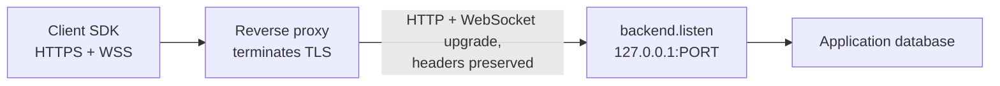

# Deploy the backend

This page describes the deployment configuration the current backend supports and where its trust boundaries lie. It documents what the listener does today; it does not promise capabilities the runtime does not have.

## What the listener is

`backend.listen({ port, host? })` starts one Node HTTP server inside your application's process. It serves `POST /sync/handshake`, durable `POST /sync/mutations`, direct `POST /sync/actions`, `POST /sync/fetch`, `POST /sync/materialize`, `POST /sync/pull` and the WebSocket upgrade on `/sync/live` on one port. Everything else answers `404`; other methods answer `405`.

| Property | Current behavior |
| --- | --- |
| Process placement | Embedded in the Node process that runs your handlers and loaders. One process per backend instance. |
| Bind address | `host` defaults to `127.0.0.1`. Pass `0.0.0.0` or `::` only when something in front of the process controls who can reach it. |
| TLS | Not built in. The listener speaks plain HTTP and `ws://`. |
| CORS, compression, request logging | Not built in. |
| Proxy headers (`X-Forwarded-*`, `Forwarded`) | Not read by the runtime. `authenticate` receives the raw Node `IncomingMessage`; nothing rewrites the client address or scheme. |
| Body and frame limits | HTTP bodies over 1 MiB answer `413 request_too_large`; WebSocket frames over 1 MiB close the socket. The limits are fixed. |
| Live wakeups | Process-local. A commit in this process wakes the subscribers connected to this process. Distributing wakeups across several processes needs application infrastructure and is not supported yet. |
| Shutdown | `await server.close()` stops new upgrades, closes live sockets with `1001`, then closes the listener. Your application closes its database pool separately. |

## Supported configuration

Run the backend on loopback and put a reverse proxy in front of it. The proxy owns TLS, the public hostname and any request logging; the backend owns authentication and the sync protocol.



The proxy must do three things:

1. **Forward the POST routes** (`/sync/handshake`, `/sync/mutations`, `/sync/actions`, `/sync/fetch`, `/sync/materialize` and `/sync/pull`) to the loopback listener unchanged, including the request body. The body limit is enforced by the backend; a stricter limit at the proxy is fine.
2. **Pass the WebSocket upgrade through** on `/sync/live`. The upgrade is an HTTP `GET` with `Upgrade: websocket`; the proxy has to forward that request and then relay bytes in both directions until either side closes. Set the proxy's idle timeout for this route long enough for a quiet subscription: the backend sends nothing while no record changes.
3. **Preserve the `Authorization` header** on every request and on the upgrade. Both SDKs send `Authorization: Bearer <token>`, and `authenticate` reads it from the forwarded request. A proxy that strips or replaces it makes every request `401` and refuses every upgrade. The same goes for any `headers` your clients send for [`admit`](api.md#admission), and for the `axton-admission` response header on the way back: without it a refusal is an ordinary error that clients retry.

A minimal nginx location that meets these requirements:

```nginx
location /sync/ {
    proxy_pass         http://127.0.0.1:4242;
    proxy_http_version 1.1;
    proxy_set_header   Upgrade $http_upgrade;
    proxy_set_header   Connection "upgrade";
    proxy_set_header   Authorization $http_authorization;
    proxy_read_timeout 3600s;
}
```

Use your own token format and verify it in `authenticate`; `devAuth` trusts the header verbatim and is for local development only ([Authentication](api.md#authentication)).

## Trust boundaries

- **Everything reaching the listener is trusted to have come through your proxy.** The runtime does not authenticate the proxy and does not read forwarded-for headers, so bind to loopback (or a private interface) and let the proxy be the only route in.
- **Identity comes from `authenticate` alone.** The user id it returns is the owner used for every host operation in that request. Admission binds the Store to its authenticated principal and Stream; a mismatched binding answers `403 store.binding` ([Errors](api.md#errors)). Give each signed-in user their own local client database ([Authentication and account changes](../frontend/sync.md#accounts-and-cache-authority)).
- **Authorization is application code.** Required `protocol5.authorizeStream` decides whether the principal may use the bound Stream (`403 stream.forbidden`). Handlers decide what a user may write and Loaders decide what a user may see ([What your backend owns](api.md#what-your-backend-owns)).

## Verification scope

The maintained [protocol-5 host runner](https://github.com/zanminwang/axton/blob/main/integration/v05-sdk/run-host.sh) exercises generated SDKs against real loopback HTTP/WebSocket and PostgreSQL. It is not a reverse-proxy or TLS certificate. Historical v0.4.2 proxy evidence is in [runtime.test.mjs](https://github.com/zanminwang/axton/blob/v0.4.2/integration/persistence/server/runtime.test.mjs); it does not establish current protocol-5 proxy behavior.

Verify TLS termination, route allowlists, header forwarding and WebSocket timeouts in your deployed proxy. Browser support and multi-process wake delivery remain separate decisions. Process-local wakes do not notify sockets attached to another backend process until their next recovery request.

## Protocol 5 adoption

Coordinate a breaking backend/adapter/generated-SDK release. Protocol 5 uses discriminator 5; malformed or incompatible requests must not reach business execution. Application minimum-build admission is a separate policy.

Install the PostgreSQL DDL into a fresh framework namespace before traffic; the installer refuses an existing legacy namespace intact. No production migration is supplied. Keep the old release and server available while unresolved protocol-4 work is drained or exported using the old release under a separately owned recovery process. Protocol 5 requires a fresh local format-5 file and refuses an old file without changing its database, WAL or SHM. It offers no automatic wipe or in-place conversion.

Review installed host and matching iOS/Android artifacts from the same tagged commit before rollout. Host-only native tests do not establish mobile installation or device startup. Large complete constraint components can hold the SQLite writer and backend transactions for seconds; validate staging space and actual capacity on target devices.

Publication, backend deployment, legacy-table cleanup and old-server retirement require separate authorization. The historical 0.3 Stream/authority cutover recipe is not a protocol-5 local migration procedure.
